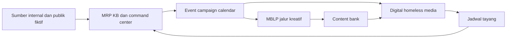

# Struktur organisasi latihan

Peserta tetap di sub-fungsi aslinya. Daftar nama: `knowledge-base/company/roster.md`.

## Market Research & Pricing

| Peran | Jenis | Pemegang |
| --- | --- | --- |
| Approver MRP | Manusia | Antonny Fayen Budiman |
| CoS MRP | Agen | Satu-satunya penulis KB bersama dan command center |
| Data Cleaner MRP | Agen | Bersihkan sumber internal dan publik |
| Report Writer MRP | Agen | Laporan mingguan dari command center |

## Event Management

| Peran | Jenis | Pemegang |
| --- | --- | --- |
| Approver Event | Manusia | Endo Eko Satryo |
| CoS Event | Agen | Orkestrator; menulis campaign calendar; laporan status ke MRP |
| Event Planner | Agen | Rundown event nasional dan aktivasi sponsorship |
| Comms Drafter | Agen | Batas pesan acara dan holding statement fiktif |

## Marketing, Brand & Loyalty

| Peran | Jenis | Pemegang |
| --- | --- | --- |
| Approver MBLP | Manusia | Kania Hapsari |
| CoS MBLP | Agen | Menjaga urutan jalur kreatif; laporan status ke MRP |
| Content Planner / Writer | Agen | Planning dan draft |
| Creative Lead agen | Agen | Arahan creative dan content bank |

## Digital Marketing

| Peran | Jenis | Pemegang |
| --- | --- | --- |
| Approver Digital | Manusia | Fachrizal Imaduddin |
| CoS Digital | Agen | Homeless media, brief ke MBLP, jadwal tayang |
| Performance Reader | Agen | Reach, impression, engagement, ecommerce |
| Scheduler | Agen | Menyesuaikan content bank dengan calendar Event |

## VP

Heppy Wulansari menyetujui materi lintas fungsi. Leni Nur Indah Sari mencatat keputusan di `knowledge-base/decisions/`.

## RACI ringkas

| Output | MRP | Event | MBLP | Digital | VP |
| --- | --- | --- | --- | --- | --- |
| KB dan command center | A | C | C | C | I |
| Campaign calendar | C | A | C | C | I |
| Content bank | C | C | A | C | C |
| Jadwal tayang | C | C | C | A | I |
| Laporan mingguan | A | C | C | C | C |

## Eskalasi

1. Spesialis ke CoS sub-fungsi.
2. CoS menulis draf dan laporan status ke MRP.
3. Manager sub-fungsi memutuskan.
4. Konflik lintas fungsi atau rilis publik: VP memutuskan.
